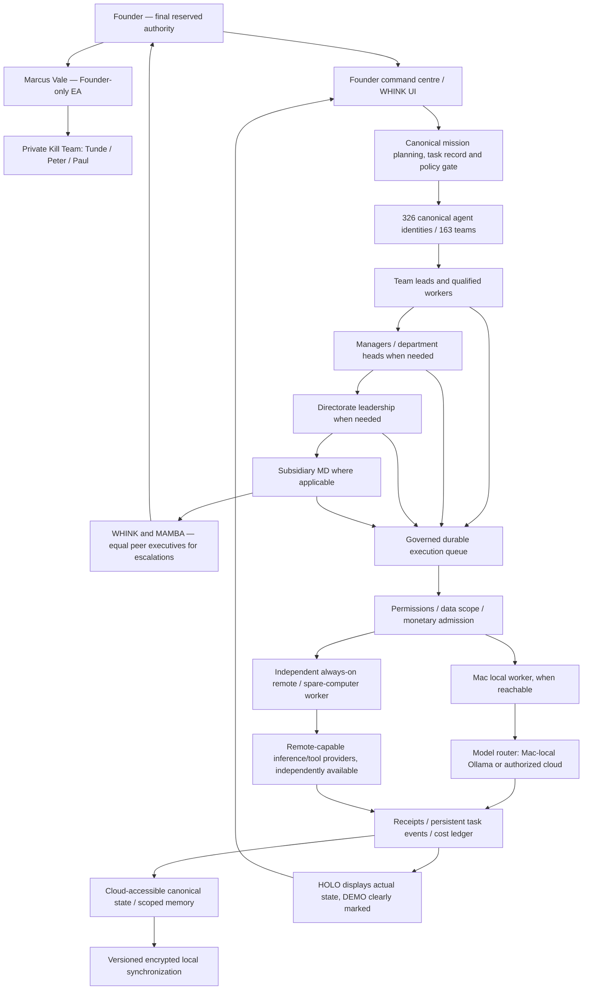

# WHINK Ultimate | Architecture Baseline
**v0.3 — Founder-approved functional baseline and six corrections.** Vendor selections and specific migrations remain open; deployment/paid actions not approved.

## 1. Mission and priority
Build **WHINK Ultimate** as a coherent, single-user (for now), Founder-governed, 326-agent AI organization. It shall operate **continuously 24/7 even while the Founder’s Mac is fully powered off** (`FDR-006`), prioritize local execution whenever available (`FDR-008`), intelligently escalate to permitted cloud AI (`FDR-009`), maintain centrally authoritative shared memory (`FDR-007`), preserve privacy and all agent identities, and truthfully show execution in HOLO (`FDR-013`). Commercial white-label work is postponed, **not** always-on capability (`FDR-011`). Speed, accuracy, autonomy, efficiency, security and zero unauthorized monetary spend remain operational objectives.

## 2. Target functional architecture (proposed implementation pattern)

The diagram is a **logical responsibility and execution map**: the escalation arrows are conditional, not a command for mandatory hops. It is a **target**, not proof of current operation. Off-device worker, memory and control endpoint are mandatory *capabilities*; hosting products, costs and deployment approach are **not selected**. ChatGPT-to-Codex execution cannot be labeled integrated until independently proven. A local-only route cannot provide Mac-off operation on its own.

## Founder-approved corrections — 30 October 2026 (binding)

These six changes were explicitly approved together, followed by an instruction to start Codex implementation. They refine—not replace—FDR-001..023. Source: Founder approval in project conversation; exact approval timestamp may depend on client transcript.

- **FDR-024 / C1 Organizational authority:** Route routine work to the lowest competent level: team leads → managers → department directors → subsidiary MDs where applicable → WHINK/MAMBA only for material escalations. WHINK and MAMBA are equal executive peers, not mandatory approval hops. Founder retains reserved authority. This is a responsibility hierarchy, not six mandatory serial inference calls.
- **FDR-025 / C2 Founder-private team:** Marcus Vale is Founder-only EA reporting exclusively to Founder and managing the Founder-private Kill Team, including Tunde (UX review), Peter and Paul (reverse engineering). Keep personnel, tasks, memory and evaluation separate from ordinary directorates. No executive may access sealed intelligence by role or persona alone.
- **FDR-026 / C3 Mission continuity:** A Founder-approved mission can delegate/activate eligible existing agents within its exact scopes without a separate approval per harmless internal step. If an assignee fails/unavailable, a qualified existing agent may temporarily cover immediately within the same permissions/budget; notify the responsible manager and audit the transfer. Permanent reassignment, elevated access and protected actions need appropriate approval. Never invent a new permanent agent as a workaround.
- **FDR-027 / C4 Mac-off architecture:** Deliver Mac-independent 24/7 operation in this build. Assess the existing spare computer as the first off-device worker candidate and an eligible no-new-cost cloud-accessible authoritative store as a candidate; **neither is assumed available, secure, free or operational**. Independently test Mac fully off and reconnection. Remote inference must not depend on Mac Ollama. Never buy or deploy unapproved infrastructure.
- **FDR-028 / C5 Activation/count reconciliation:** Preserve 326 canonical identities and 163 teams. The Founder identified AI Organization and Autonomous Operations as the sixteenth directorate. Its leadership entry is on an unmerged Integrations branch, while departments and agent/team assignments remain open; do not invent or move identities to fill the gap. Mission-scoped activation is bounded by approved policy and does not imply 326 concurrently loaded models.
- **FDR-029 / C6 Anti-drift:** Version decision IDs, baseline and traceability. Every engineering ticket and PR maps changed files and tests to FDR/REQ IDs. An automated check should reject a missing traceability/ADR/approval requirement for governed boundary changes. Codex cannot self-authorize deviations; independent reviewer and Founder acceptance are mandatory at milestone gates.

## 3. Ownership rules and non-substitutability
| Layer | Sole authority / responsibility | Not allowed |
|---|---|---|
| Founder | Approvals, budgets, policy, architecture changes, protected actions, release | Silent inferred approvals. |
| WHINK/MAMBA | Executive strategy, org mission, independent challenge, delegation and learning policy | Override Founder by persona. |
| Org-kit | 326 persistent identities, 163 teams, 570 skills and canonical hierarchy; active availability via event/job scheduling | Spawn 326 simultaneous LLM processes; create competing cloud roster. |
| Governed task plane | Unified task lifecycle, context, authorization, queue, leases, recovery and audit | Mark approved as dispatched; uncancellable duplicate sends. |
| Local runner | Latency/cost-optimized processing on Mac while reachable | Be assumed available when Mac is powered off. |
| Off-device always-on worker | Continue approved schedules, events, monitoring, approved tasks and approvals when Mac is off | Bypass monetary/data/agent policy. |
| WHINK model router | Local vs permitted cloud provider selection; quality checks; escalation, accounting | Auto-bill an unapproved cloud provider; hard-code unbenchmarked default. |
| Ollama | Existing local inference server/backend | Authority over WHINK governance; forced long-term vendor lock-in. |
| OpenClaw components | Candidate reused tools/channels/schedulers/models *under* WHINK contract | Become unreviewed second owner/agent hierarchy or unsafe full-tools gateway. |
| Central memory | Authoritative state and persistent identity, task journal, learning records, sync versions | Unrestricted sharing of sealed Founder intelligence. |
| HOLO | Hybrid visual and practical executive interface informed by real state | Generate deceptive live activity from fixtures. |

## 4. Always-on requirement in THIS build (`FDR-006`, `FDR-007`)
- Always-on means core schedules, durable work queues, event intake, memory, progress, approval presentation and permitted tasks are reachable/continue **without relying on the Mac's power or network connection**.
- A remote/off-device runtime and persistent cloud-accessible state **must exist and be tested**. The Mac is a preferred executor when it is online; it is never the sole owner of continuity.
- When Mac disconnects or powers off, work assigned to it must be checkpointed or safely reclaimed after a lease expires; no duplicate externally visible actions. Local-only/private tasks that cannot safely run remotely may **pause visibly**; this must not be misreported as 24/7 completion.
- Remote runtime must have explicit capability, credential, privacy and monetary scopes. No assumption that a remote host, storage or cloud model is free. **If safe compliant off-device capacity is unavailable under the zero-new-spend constraint, flag a hard release blocker and provide costed alternatives for Founder decision. Do not defer the requirement or activate an unapproved paid host.**
- Acceptance requires independent Mac-off tests: turn Mac fully off; prove remote schedule/queue processing, remote state persistence, user-visible approval and continuity, then Mac reconnection/sync without duplicate or lost tasks.

## 5. Local-first and hybrid AI (`FDR-008`, `FDR-009`, `FDR-010`, `FDR-014`, `FDR-015`)
- Start locally for eligible tasks when Mac/resources are available, with bounded concurrency on 16 GiB. **Quality, safety and job deadline**, not low cost alone, determine whether local success is acceptable.
- Route to another authorized provider, including cloud, when local fails/underperforms/is unavailable. Carry forward permitted context, redacted private information, idempotency and audit reasons. No automatic paid call unless a valid spending authorization/cap exists. `BLOCKED_COST` is a truthful possible outcome.
- Off-device always-on task processing does not mandate cloud LLM inference on every tick: schedulers and read-only event processing may function without invoking an LLM. Model selection is *unresolved* pending safe Qwen/Gemma paired tests. Keep installed Ollama until evidence warrants an approved change.

## 6. OpenClaw capability ownership (`FDR-012`)
Codex must build an evidence matrix of upstream capabilities: `{integration adapter, license-compliant code reuse, keep WHINK existing, exclude}`. Avoid wholesale replacement. The installed upstream OpenClaw is distinct from `services/openclaw` (WHINK-owned MCP gateway); audit observed different protocols and no established WHINK-to-upstream link. A direct URL swap is not an integration. No auto-connection while full-tools/sandbox risks remain unreviewed. Review any extracted code licensing, attribution, security updates and white-label future constraints *without implementing white-label features now*.

## 7. HOLO and Founder Command Centre (`FDR-013`, `FDR-016`)
Provide hybrid cinematic identity + useful dashboard showing real task/team progress, risk, budget, queued approvals, exceptions and the next action. Decisions and approvals happen through the Founder command centre; authorized Codex executions produce evidence for review, not a dependency on manually switching applications. The actual connector/transport is unverified; never fake successful dispatch or a live gesture stream. A camera gesture feature is not a substitute for real task events.

## 8. Preserve known reality and identify gaps
**Forensic snapshot (Codex, not independent live proof):** inspected HEAD `11ee6808b76cac128b61037d123cf25b376936ef` plus uncommitted work. Current repo implementation includes Next.js + Prisma/Postgres, 15 audited directorates, 326 agents/163 teams/570 skills. Separate work paths exist. EAR approval text can say 'TEAM DISPATCHED' without dispatch; swarm workers are analytical/no tools; HOLO agent animation is fixture-based; universal spend limit is not established; OpenClaw upstream WS 18789 ≠ WHINK MCP 3100. Some direct Gemini/standalone runner paths avoid common governance. No E2E operation was proven by that audit.
**Independent local-model evaluation:** Qwen warm median 12.77 output tokens/s over 4 scored prompts, strict full-task success 0/4; Gemma installed but not inference-tested. Filesystem reportedly reached ~140 MiB free with high swap. No model or engine superiority established. Do not load-test until safe capacity is restored with permission for any cleanup.

## 9. Baseline acceptance invariants
A. Founder-scoped permission at all paths and provider calls; zero paid calls under zero-cost policy absent explicit override. B. No agent identity/role/learning access violation. C. One durable task and truthful state history; pause/recovery/restart/idempotency proven. D. Remote continuity with the Mac **fully off**, including authoritative memory. E. Local-first when reachable and permitted cloud escalation. F. HOLO only reflects authenticated, persisted events. G. No new white-label/multi-user build scope. H. No replacement of uncommitted work without approval. I. No model choice without paired evidence. J. No silent architectural deviations.
## 10. Special clarification: approved work scope
The Founder authorized incremental implementation, starting with M0/M1, on 30 October 2026. This authorization is not permission for live deployment, paid hosting, model-switch benchmarking under unsafe disk conditions, protected action or destructive change. FDR-024..029 govern details not fully expressed by v0.2.
