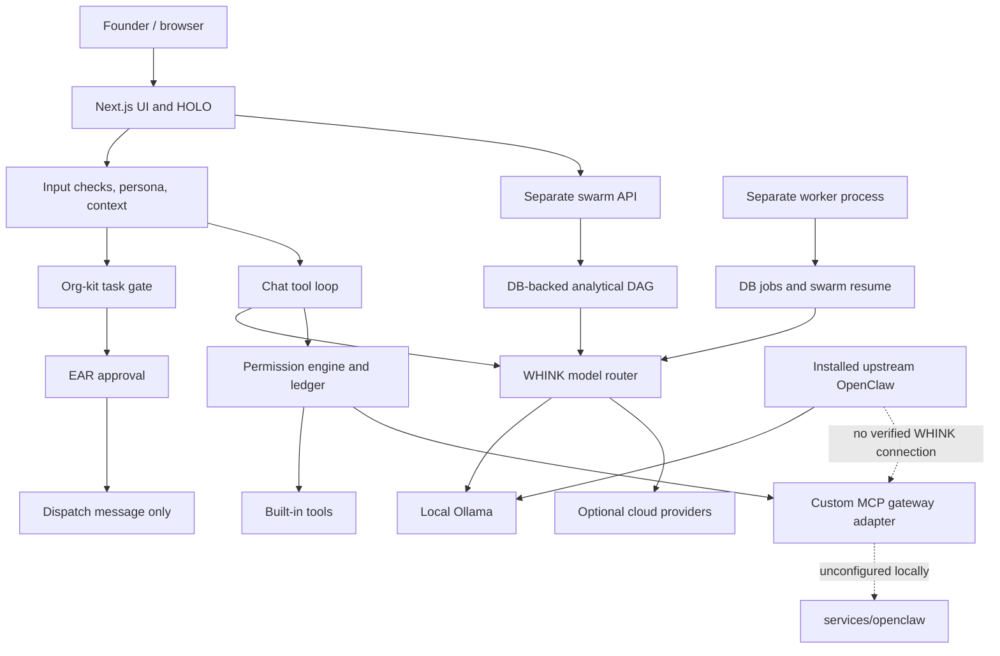

**1. Executive verdict**

**KAMSI-PRIME has evolved beyond its early integration-oriented design, but the evidence does not support calling the entire system an unnecessary duplication of OpenClaw.**

The strongest findings are:

- **The gateway change was deliberate and documented.** On October 3, WHINK adopted its own MCP gateway behind an adapter instead of relying on the referenced upstream OpenClaw image.
- **Two different systems now carry the OpenClaw name:** the repository’s custom MCP gateway and a separately installed upstream OpenClaw runtime. I found no configured connection between them.
- **Execution is fragmented.** Chat tools, org-kit EARs, analytical swarms, background jobs, and an uncommitted local coding runner follow different paths.
- **Some apparent functionality exceeds what its execution path actually does.** EAR approval produces “TEAM DISPATCHED” text without dispatching agents. HOLO’s orb states come from fixtures.
- **WHINK’s governance, organizational registry, tenant isolation, and business state are necessary product functionality.** Replacing them with OpenClaw would not automatically simplify the system.
- **Recommendation: C — selective integration without major restructuring.** Preserve WHINK/MAMBA authority and Founder controls; first unify execution contracts and truthful status reporting, then evaluate a bounded OpenClaw adapter.

Audit baseline: commit `11ee6808b76cac128b61037d123cf25b376936ef`, plus the existing working-tree changes inspected separately. No files, configuration, agents, or services were changed. No inference, sends, installations, or deployments were performed.

**2. Original architecture evidence**

The supplied hypothesis is **partially supported**, not established as one original, consistently implemented specification.

| Hypothesis                                                | Historical evidence                                                                                               | Finding                                                                     |
| --------------------------------------------------------- | ----------------------------------------------------------------------------------------------------------------- | --------------------------------------------------------------------------- |
| WHINK/MAMBA provide executive intelligence and governance | Initial commit `36e802d`, `CLAUDE.md:10–14`: two minds share memory and permissions; persona never changes access | **Supported**                                                               |
| 326 agents and 163 teams                                  | Org-kit introduced in `720b959`, October 1; historical handoff describes those counts                             | **Supported from October 1 onward**, not established in the earliest import |
| OpenClaw provides actions/integrations                    | Initial decision log, dated September 23, identifies “OpenClaw (actions)”                                         | **Supported**; exclusive ownership of all orchestration is **UNKNOWN**      |
| HOLO provides the visual interface                        | Gesture/rendering implementation introduced October 23; architecture document added October 24                    | **Supported as a later direction**; not proven part of the earliest design  |
| Ollama provides local inference                           | Model-router/local-provider design and later local-first handoffs                                                 | **Supported**, but the architecture also explicitly allowed cloud models    |

The earliest imported decision log describes **WHINK core + ADA V2 + OpenClaw + AnythingLLM + model router**. It does not describe a minimal five-component system with OpenClaw owning every execution concern. See the surviving [Super Jarvis decision (line 190)]\(/Users/victorcheckingin/KAMSI-PRIME/docs/decisions.md:190).

The most consequential documented change is explicit:

> “WHINK builds its own MCP gateway in `services/openclaw`”

The rationale was transport isolation, swappability, and a referenced upstream image being unavailable—not an undocumented decision to rebuild all of OpenClaw. The log attributes the October 3 decisions to Victor, relayed through the orchestrator, with checklist confirmation still required. [Decision and alternatives (line 151)]\(/Users/victorcheckingin/KAMSI-PRIME/docs/decisions.md:151), [approval attribution (line 124)]\(/Users/victorcheckingin/KAMSI-PRIME/docs/decisions.md:124).

There are significant documentation contradictions:

- [ARCHITECTURE.md (line 5)]\(/Users/victorcheckingin/KAMSI-PRIME/ARCHITECTURE.md:5) describes 16 directorates, Tauri, Python MediaPipe, SQLite auditing, and Claude as primary.
- The inspected registry contains **15 directorates**.
- Current application code is Next.js with Prisma/Postgres.
- The action ledger is represented in the Postgres schema.
- Local configuration selects Gemma.
- The autonomous handoff proposes a future local-only policy that blocks OpenClaw/MCP in that mode.

**Conclusion:** `ARCHITECTURE.md` is historical design evidence, not a reliable description of the current running system.

**3. Current architecture map**

````

````

**Command authority.** WHINK/MAMBA persona selection, input screening, context assembly, and prompt construction occur in [orchestrator.ts (line 69)]\(/Users/victorcheckingin/KAMSI-PRIME/apps/web/lib/orchestrator.ts:69). Permissions remain independent of persona in [permission-engine.ts (line 62)]\(/Users/victorcheckingin/KAMSI-PRIME/apps/web/lib/permission-engine.ts:62). This preserves the original distinction between executive voice and authorization.

**Chat execution.** The message route invokes the orchestrator, intercepts task directives, or enters the model/tool loop. Gateway tools are resolved through an adapter and combined with standard tools. Tool calls pass through `executeTool` and permission checks. [Message route (line 179)]\(/Users/victorcheckingin/KAMSI-PRIME/apps/web/app/api/conversations/[id]/messages/route.ts:179), [gateway registration (line 17)]\(/Users/victorcheckingin/KAMSI-PRIME/apps/web/lib/gateway-chat.ts:17), [tool execution (line 957)]\(/Users/victorcheckingin/KAMSI-PRIME/apps/web/lib/tool-registry.ts:957).

**Org-kit delegation.** The org-kit router scores registry agents and proposes a team; it does not invoke a model or execute work. More importantly, the approved EAR branch finishes by generating a dispatch message. It does not invoke the swarm engine or another executor. The message nevertheless says the team is active. This is a **confirmed execution/status mismatch**. [Router (line 1)]\(/Users/victorcheckingin/KAMSI-PRIME/packages/org-kit/src/router.ts:1), [EAR approval branch (line 509)]\(/Users/victorcheckingin/KAMSI-PRIME/apps/web/lib/approvals.ts:509), [dispatch text (line 42)]\(/Users/victorcheckingin/KAMSI-PRIME/apps/web/lib/approval-handler.ts:42).

**Swarm execution.** A separate system plans and assigns tasks to real org-kit agents, persists a dependency graph, claims lanes, retries, and aggregates outputs. Its agents explicitly receive **no tools**: this is analytical collaboration, not general autonomous execution. [Assignment (line 23)]\(/Users/victorcheckingin/KAMSI-PRIME/apps/web/lib/swarm/assign.ts:23), [engine (line 64)]\(/Users/victorcheckingin/KAMSI-PRIME/apps/web/lib/swarm/engine.ts:64), [agent contract (line 50)]\(/Users/victorcheckingin/KAMSI-PRIME/apps/web/lib/swarm/agent-call.ts:50).

**Memory and persistence.** Postgres holds application memory, working memory, approvals, jobs, swarm state, and ledger records. Context assembly applies a character budget and blends memory with optional document retrieval. These are distinct responsibilities, not automatically redundant databases. [Working memory (line 1)]\(/Users/victorcheckingin/KAMSI-PRIME/apps/web/lib/working-memory.ts:1), [context assembly (line 48)]\(/Users/victorcheckingin/KAMSI-PRIME/apps/web/lib/context-engine.ts:48), [schema (line 343)]\(/Users/victorcheckingin/KAMSI-PRIME/apps/web/prisma/schema.prisma:343).

**Scheduling and recovery.** There are multiple mechanisms:

- Next.js startup launches scheduled-post and briefing workers.
- A separate worker process uses Postgres leases and `SKIP LOCKED`.
- Swarms have separate lane claims, heartbeats, retries, and resumption.

These serve different workloads, but lifecycle and recovery logic overlap. A swarm timeout races a promise without passing cancellation into the model call; a timed-out request may continue while retry logic proceeds. That is a concrete potential source of duplicate inference expenditure. [Startup workers (line 6)]\(/Users/victorcheckingin/KAMSI-PRIME/apps/web/instrumentation.ts:6), [job claims (line 64)]\(/Users/victorcheckingin/KAMSI-PRIME/apps/web/lib/worker/scheduler.ts:64), [swarm timeout (line 85)]\(/Users/victorcheckingin/KAMSI-PRIME/apps/web/lib/swarm/engine.ts:85).

**4. OpenClaw integration findings**

There are **two separate OpenClaws**.

| Dimension           | Repository gateway                 | Installed upstream OpenClaw                   |
| ------------------- | ---------------------------------- | --------------------------------------------- |
| Identity            | WHINK-owned MCP aggregator         | npm package `openclaw`, version **2026.10.8** |
| Transport inspected | MCP over streamable HTTP, `/mcp`   | Gateway WebSocket architecture                |
| Expected local port | 3100                               | 18789                                         |
| Agent execution     | Upstream tool forwarding           | Independent agent runtime                     |
| WHINK connection    | Adapter implemented                | **Not established**                           |
| Local state         | No running gateway container found | Loopback listener and LaunchAgent found       |

The repository service depends on the MCP SDK; its package is not the upstream OpenClaw runtime. Its compose definition builds local source and applies container hardening. [Gateway compose (line 8)]\(/Users/victorcheckingin/KAMSI-PRIME/services/openclaw/docker-compose.yml:8).

The WHINK adapter is opt-in: without `OPENCLAW_URL`, it makes no connection. That variable was absent from the inspected app configuration and inherited audit environment. The service-specific `.env` and local override config were absent. Docker listed only the Postgres container. [Adapter configuration gate (line 43)]\(/Users/victorcheckingin/KAMSI-PRIME/apps/web/lib/openclaw-client.ts:43).

Upstream OpenClaw inspection established:

- Installed package and configuration present.
- Token authentication and loopback binding configured.
- One configured agent entry, `main`.
- Ollama configured as provider.
- Default model `ollama/qwen3.5:4b`.
- Tools profile `full`.
- No explicit global or per-agent sandbox configuration found.
- No channel configuration found in the inspected main config.

Its configured model was **not among the two models returned by the local Ollama inventory**. This is a configuration mismatch; successful inference remains **UNKNOWN**.

Installed-version documentation says sandboxing is off by default. Consequently, the observed configuration does **not establish sandboxed execution**. [Installed sandbox documentation (line 9)]\(/opt/homebrew/lib/node_modules/openclaw/docs/gateway/sandboxing.md:9).

The protocols also differ. Simply pointing WHINK’s MCP URL at upstream OpenClaw’s gateway is not a demonstrated integration. [WHINK transport (line 1)]\(/Users/victorcheckingin/KAMSI-PRIME/apps/web/lib/openclaw-client.ts:1), [installed gateway protocol (line 78)]\(/opt/homebrew/lib/node_modules/openclaw/docs/concepts/architecture.md:78).

Upstream OpenClaw documents agent routing, channels, scheduling, and optional sandboxing. Those are plausible integration opportunities, but its execution approvals are not evidence of equivalence to WHINK’s money/proprietary-information policy. [Official architecture](https://docs.openclaw.ai/concepts/architecture), [multi-agent routing](https://docs.openclaw.ai/concepts/multi-agent), [execution approvals](https://docs.openclaw.ai/tools/exec-approvals).

**5. HOLO integration findings**

**HOLO is implemented as an application interface, but live agent visualization and end-to-end hand tracking are not established.**

Confirmed code:

- Three.js orb rendering and interaction.
- Ledger and pending-approval API reads.
- Persona-switch and meeting actions.
- Gesture request validation, HMAC verification, nonce checks, classification, dispatch, and an SSE state bridge.

However:

- The orb field initializes from `fixtureAgents()`.
- A timer changes fixture states every two seconds.
- Gesture server code exists, but repository searches did not locate a production hand-capture client connected to these endpoints.
- No consumer of `/api/gesture/stream` was found in the inspected application source.
- No independent Tauri/Python HOLO runtime was established.

[Fixture wiring (line 109)]\(/Users/victorcheckingin/KAMSI-PRIME/apps/web/components/holo/holo-surface.tsx:109), [generated agent identities (line 20)]\(/Users/victorcheckingin/KAMSI-PRIME/apps/web/components/holo/holo-fixtures.ts:20), [gesture endpoint (line 13)]\(/Users/victorcheckingin/KAMSI-PRIME/apps/web/app/api/gesture/route.ts:13), [SSE bridge (line 9)]\(/Users/victorcheckingin/KAMSI-PRIME/apps/web/app/api/gesture/stream/route.ts:9).

**Status:** implemented rendering and server-side gesture processing; live operational integration **UNKNOWN/incomplete**. Existing screenshots are historical artifacts, not proof of current operation.

**6. Integration verification and duplication matrix**

“Installed” below means local files/dependencies or a service installation were observed. It does not mean the feature works.

| Component                       | Documented         | Implemented         | Locally installed                   | Configured                               | Connected / operational evidence                            |
| ------------------------------- | ------------------ | ------------------- | ----------------------------------- | ---------------------------------------- | ----------------------------------------------------------- |
| WHINK/MAMBA core                | Yes                | Yes                 | App dependencies present            | Partial                                  | No running web listener observed; end-to-end **UNKNOWN**    |
| Org-kit                         | Yes                | Yes                 | Registry present                    | 326 agents, 163 teams, 570 skills        | Registry counts verified; agent execution **not verified**  |
| Custom MCP gateway              | Yes                | Yes                 | Source; service dependencies absent | App endpoint absent                      | No running container; connection not established            |
| Upstream OpenClaw               | Yes, external docs | External runtime    | **2026.10.8**                       | Yes                                      | Listener observed; authenticated operation **UNKNOWN**      |
| HOLO                            | Yes                | Partial integration | App source/dependencies             | Fixture display                          | Live agent/gesture functionality **UNKNOWN**                |
| Ollama                          | Yes                | Router implemented  | Yes                                 | Local Gemma selected                     | Metadata API responsive; inference deliberately untested    |
| Postgres                        | Yes                | Prisma integration  | Container running                   | Loopback port 5433                       | Docker reports healthy; schema/data correctness **UNKNOWN** |
| AnythingLLM                     | Yes                | Adapter and compose | No running container found          | App settings absent in inspected files   | **Unverified**                                              |
| Background worker/swarm         | Yes                | Yes                 | Source available                    | DB-backed design                         | No execution/recovery test performed                        |
| SMTP/SMS                        | Yes                | Sending code exists | App code present                    | Credentials absent in inspected app file | Delivery **unverified**                                     |
| WhatsApp/Telegram/contact calls | Yes                | Delivery stubs      | Source only                         | Not established                          | **Not operationally established**                           |
| Local Gemma coding runner       | Uncommitted work   | Yes                 | Script present                      | CLI entry added                          | Never run during audit                                      |

Ollama inventory returned `gemma4:12b-it-qat` and `wink-qwen3.5-9b-8k:latest`. The inspected app configuration targets local Ollama and Gemma for default/swarm/local use. Cloud-provider support remains implemented; a cloud credential variable was populated, with its value never exposed.

The meaningful duplication is:

| Capability          | WHINK implementation                                 | OpenClaw overlap              | Assessment                                                                           |
| ------------------- | ---------------------------------------------------- | ----------------------------- | ------------------------------------------------------------------------------------ |
| Model/tool loop     | Chat loop plus local coding runner                   | Agent loop                    | **Genuine functional overlap**, but different policy and workload boundaries         |
| Agent selection     | Org-kit team router plus swarm assignment            | Agent routing                 | Internal duplication is clearer than upstream equivalence; preserve roster semantics |
| Scheduling/recovery | Web timers, DB jobs, swarm claims                    | Gateway scheduling/automation | Consolidation opportunity; exactly-once business actions need separate treatment     |
| Memory/context      | Tenant-scoped business memory and recall             | Agent/session memory          | Partial overlap; not safe to replace blindly                                         |
| Channels            | Custom SMTP/SMS/social paths                         | Channel plugins               | Integration opportunity; approval/consent controls must survive                      |
| Permissions         | Class A/B/C, protected actions, hash-bound approvals | Tool policy/exec approvals    | **Necessary WHINK-specific governance**, not disposable duplication                  |
| HOLO                | Branded visualization and controls                   | Gateway/control interfaces    | Necessary product interface                                                          |
| Audit               | Business ledger plus standalone runner JSONL         | Runtime records               | Multiple audit authorities; correlation is missing                                   |
| Business records    | Projects, contracts, finance, contacts               | No equivalence established    | **KEEP**                                                                             |

**Additional boundary findings**

The uncommitted [local coding runner (line 122)]\(/Users/victorcheckingin/KAMSI-PRIME/apps/web/scripts/local-gemma-agent.ts:122) has its own Ollama loop, tool dispatcher, `--write` switch, child-process execution, and JSONL audit. It does not use the application permission engine or action ledger. It is a separate developer utility, not proven integrated WHINK execution.

Its path checks are lexical, and child processes inherit the environment. These are not equivalent to OS sandboxing. Treat integration of this runner as a security review item, not as completed local autonomy. [Path checks (line 33)]\(/Users/victorcheckingin/KAMSI-PRIME/apps/web/scripts/local-gemma-agent.ts:33), [process execution (line 79)]\(/Users/victorcheckingin/KAMSI-PRIME/apps/web/scripts/local-gemma-agent.ts:79).

The content analyst also calls Gemini directly, outside the application router. This is another independent inference boundary; current use is **UNKNOWN**. [Direct provider request (line 360)]\(/Users/victorcheckingin/KAMSI-PRIME/services/whink-content-analyst/analyst.js:360).

**7. Architectural drift timeline**

Git authorship identifies who recorded a change, not necessarily who approved its requirements.

| Date / commit                                             | Change                                                                | Attribution and documented reason                                                                                           |
| --------------------------------------------------------- | --------------------------------------------------------------------- | --------------------------------------------------------------------------------------------------------------------------- |
| September 23 decision, imported September 27 in `36e802d` | WHINK core with swappable action, voice, and document services        | Initial import by Victor; licensing and product ownership rationale                                                         |
| October 1, `720b959`                                      | Model router, Postgres, org-kit                                       | Victor-authored; “own the stack,” remove Abacus dependency                                                                  |
| October 3, `4f7fb34`                                      | Custom MCP aggregator replaces reliance on referenced upstream image  | Victor-authored, Claude co-authored; explicit decision log attributes approval to Victor                                    |
| October 12–19, `dc4cca0`, `a8580de`                       | Separate calling/content-analysis services                            | WHINK-authored commits; detailed Founder authorization **UNKNOWN**                                                          |
| October 22–23, `07615e2`, `3dbfcef`                       | Additional agent routing and HOLO/gesture implementation              | Claude-authored; gesture mapping explicitly recorded as needing confirmation                                                |
| October 24, `de33bc3`                                     | Architecture/handoff documentation added                              | Victor-authored; describes components not fully reflected in implementation                                                 |
| October 25–26, `b4e69dc`                                  | Durable worker, analytical swarm, skill pipeline, business operations | Claude-authored; commit documents functionality; specific Founder authorization for each architectural addition **UNKNOWN** |
| October 27, `b698c7c`, `94542dd`                          | Local Qwen defaults and fast path                                     | Victor-authored local-first direction                                                                                       |
| October 27, `2f0d331`                                     | Late-approval council                                                 | Victor-authored; actual behavior is deterministic policy, not model deliberation                                            |
| October 28, `11ee680`                                     | SMTP and local routing improvements; current HEAD                     | Victor-authored                                                                                                             |
| Uncommitted working tree                                  | Native Ollama tools and standalone Gemma runner                       | Author/date/approval **UNKNOWN from Git**                                                                                   |

The late-approval council deserves precise labeling: it assigns the same deterministic eligibility result to five named members. It does not consult five independent agents. Its allowlist is narrow and excludes protected/gateway actions, but it changes the older blanket “expired means denied” model. [Council implementation (line 63)]\(/Users/victorcheckingin/KAMSI-PRIME/apps/web/lib/approval-council.ts:63), [automatic reconsideration (line 254)]\(/Users/victorcheckingin/KAMSI-PRIME/apps/web/lib/approvals.ts:254).

**8. Alternative comparison**

These are architectural judgments, not measured performance results.

| Criterion                    | A. Preserve current system                        | B. Restore hypothesized integration design                | C. Selective integration                               |
| ---------------------------- | ------------------------------------------------- | --------------------------------------------------------- | ------------------------------------------------------ |
| Complexity                   | Existing fragmentation remains                    | Large migration; less custom execution only if successful | Reduce overlap incrementally                           |
| Reliability                  | Known code, unresolved dispatch/status gaps       | New adapter and migration failure modes                   | Fix observed gaps before expansion                     |
| Security                     | WHINK controls retained; side paths remain        | Risk of transferring authority to runtime defaults        | WHINK policy retained at execution boundary            |
| Performance                  | Multiple schedulers/loops; local contention       | Could improve or worsen; **UNKNOWN**                      | Measure bounded workloads first                        |
| Token efficiency             | Uneven accounting and cancellation                | No automatic savings established                          | Consolidate accounting and eliminate unnecessary calls |
| Maintainability              | Multiple contracts and stale documents            | Upstream maintenance benefit, adapter burden              | Smaller contract surface                               |
| Autonomy                     | Tools in chat; swarms text-only; EAR dispatch gap | Potentially broader tool execution                        | Add only required execution capabilities               |
| Vendor dependence            | Mixed providers, custom gateway                   | Greater OpenClaw coupling                                 | Replaceable executor/provider adapters                 |
| Migration risk               | Low immediate risk                                | **High**                                                  | **Low–moderate**                                       |
| Original-objective alignment | Preserves owned core; integration incomplete      | Matches part of hypothesis, not all historical evidence   | Best fit for governance plus swappable services        |

**C is the strongest choice.** B cannot accurately be called a simple “restoration”: the original record does not establish the complete target contract, and the installed OpenClaw system has not demonstrated compatibility with WHINK’s governance.

**Token and spending controls need correction regardless of option.**

- Monthly budget defaults to unlimited when no cap is configured.
- Worker and swarm paths check budgets.
- Chat fallback is optional and can retain the cloud model when local fallback fails.
- The model router itself has no universal user-scoped spending gate.
- Swarm usage uses approximate token counts; usage persistence is asynchronous.
- Memory extraction and debriefing introduce additional inference paths.

Therefore, **a universal hard spending ceiling is not established**. No architecture can guarantee perpetual usage credits; enforceable limits require centralized admission/accounting and stopping when the budget is exhausted. [Budget defaults (line 34)]\(/Users/victorcheckingin/KAMSI-PRIME/apps/web/lib/budget.ts:34), [fallback behavior (line 101)]\(/Users/victorcheckingin/KAMSI-PRIME/apps/web/lib/offline.ts:101), [router entry (line 161)]\(/Users/victorcheckingin/KAMSI-PRIME/apps/web/lib/model-router.ts:161), [swarm accounting (line 128)]\(/Users/victorcheckingin/KAMSI-PRIME/apps/web/lib/swarm/agent-call.ts:128).

**9. Recommended architecture**

Keep one WHINK authority boundary with replaceable execution behind it:

**Founder → WHINK/MAMBA → task/approval records → governed executor → tools/providers → results/ledger → HOLO.**

| Component                                   | Classification                   | Recommendation                                                                         |
| ------------------------------------------- | -------------------------------- | -------------------------------------------------------------------------------------- |
| WHINK/MAMBA authority                       | **KEEP**                         | Executive planning and adversarial review; no permission escalation by persona         |
| 326 agents / 163 teams                      | **KEEP**                         | Preserve identities, hierarchy, skills, and dormant defaults                           |
| Founder approval engine                     | **KEEP**                         | Retain owner scope, content hashes, protected categories, atomic decisions             |
| EAR dispatch implementation                 | **REPLACE**                      | Replace text-only success with truthful status and a real execution handoff            |
| HOLO                                        | **KEEP / INTEGRATE**             | Retain interface; bind it to real task/agent events                                    |
| Ollama/provider router                      | **KEEP / INTEGRATE**             | Centralize inference policy, accounting, cancellation, and local-only enforcement      |
| Swarm engine                                | **KEEP initially**               | Label analytical scope accurately; avoid parallel replacement during audit remediation |
| Background scheduling                       | **INTEGRATE**                    | Share lifecycle, lease, cancellation, and recovery conventions                         |
| Custom MCP gateway                          | **KEEP initially**               | Identify it clearly as WHINK’s gateway; retain adapter boundary                        |
| Upstream OpenClaw                           | **DEFER production integration** | Evaluate as a bounded executor/channel provider after contract and sandbox checks      |
| Local coding runner                         | **DEFER integration**            | Preserve uncommitted work; review sandbox, secrets, approvals, and ledger integration  |
| Postgres business memory/ledger             | **KEEP**                         | Canonical tenant-scoped application state                                              |
| AnythingLLM                                 | **DEFER activation**             | Validate pinned service/API compatibility before claiming recall works                 |
| Communication adapters                      | **INTEGRATE selectively**        | Use one authorization and delivery contract; choose transports by demonstrated benefit |
| Independent cloud-analysis/calling services | **DEFER**                        | Require explicit ownership and policy coverage before activation                       |

Do not create 326 always-running OpenClaw processes merely to preserve the roster. Preserve the organizational data and instantiate bounded work when authorized.

**10. Minimal corrective roadmap — proposal only**

1. **Reconcile the architecture record.** Document the two OpenClaw systems, actual runtime boundaries, current model configuration, and unverified features. Preserve all existing work.
2. **Correct execution claims.** EARs must remain “approved, awaiting execution” until an executor accepts them. HOLO must distinguish fixture data from live state.
3. **Define one execution contract.** Include owner, task/agent IDs, allowed capabilities, approval hash, budget, cancellation, idempotency, and ledger correlation.
4. **Close governance gaps.** Apply the same policy to background inference, standalone runners, external communication, and optional services. Describe the council as deterministic policy.
5. **Make budget enforcement comprehensive.** Account for every model path; reserve capacity before execution; cancel timed-out requests; fail closed for paid calls when limits cannot be checked.
6. **Evaluate a bounded OpenClaw adapter.** First compare installed-version interfaces and sandbox behavior using offline fixtures/mocks. Any later live model or external-action test requires separate authorization.
7. **Consolidate only after equivalence is proven.** Remove overlapping machinery only when the replacement preserves agent/team identities, Founder controls, recovery behavior, and audit records.

**11. Evidence and confidence**

**High confidence**

- Registry counts: 326 unique agents, 163 teams, 570 skills, 15 directorates; all registry agents dormant.
- Custom MCP gateway and installed upstream OpenClaw are distinct.
- EAR approval does not dispatch execution in the inspected branch.
- HOLO orb state is fixture-driven.
- Swarm agents receive no tools.
- Installed OpenClaw’s configured default model is absent from the observed Ollama inventory.
- Existing uncommitted changes remain present.

**Medium confidence**

- Selective integration would simplify the system more safely than wholesale replacement.
- Multiple execution/scheduling mechanisms create avoidable maintenance work.
- No active WHINK-to-upstream-OpenClaw connection exists in the inspected local configuration.

These conclusions are bounded by the inspected checkout, configuration files, and runtime metadata.

**UNKNOWN**

- Independent Founder authorization for every historical expansion.
- Current authenticated web-app operation and database migration completeness.
- Successful OpenClaw inference, channel delivery, and policy integration.
- Real-camera gesture operation.
- Recovery under crashes or concurrent workers.
- Actual latency, throughput, model quality, and total token savings.
- Production deployment state and credentials stored outside inspected configuration.

Verification consisted of source tracing, Git history, registry parsing, redacted configuration inspection, listener inspection, Docker status, and Ollama’s **metadata-only** model inventory. No application tests or startup commands were run because they could write state or activate background work.

The repository remains unchanged. No recommendations were implemented.