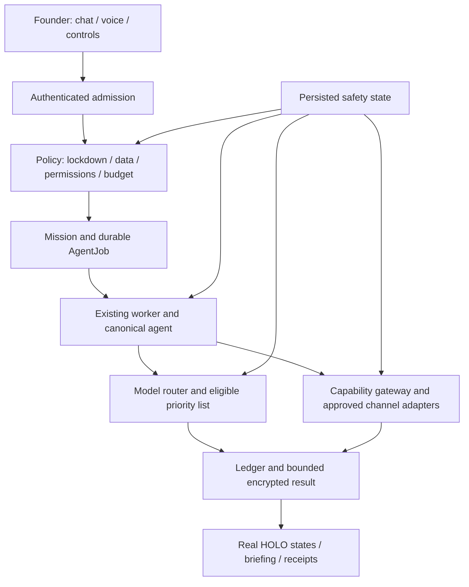

# ECHELON functional readiness architecture and VS Code execution contract

Date: 2026-11-01 (Founder locale: America/Edmonton)
Status: build specification; source inspection and recorded tests are evidence, not proof of operational completion.
Scope: close readiness items 1–10 for Founder's personal use. Preserve existing application and work. No calendar estimates. This document authorizes no purchase, merge, deployment or external message by itself.

## 1. Founder decisions and acceptance boundary

Confirmed in this conversation:
- Start with the Mac running. Mac-off operation remains a mandatory subsequent acceptance gate, not removed from scope.
- All requested communications channels must be covered: email, SMS, WhatsApp, Telegram, iMessage and phone calls; include hearing, speaking and in-app voice. A stub or launcher does not count as a working channel.
- Provide model priority controls: Founder chooses first, second and third choices and can switch saved ordering profiles. Include NVIDIA Nemotron 3 Ultra, NVIDIA-hosted DeepSeek and DeepSeek browser chat as options; retain local inference and approved paid-provider options.
- Board Room entry plays a daily briefing assembled from real tasks and approvals with motion and voice.
- Avatar instruction: add subtle blinking if it preserves existing behavior; otherwise retain breathing and mouth movement. Feature-gated rollback is mandatory. This condition supersedes the old unconditional no-blinking decision only when verified.
- Lockdown stops new jobs, outbound tools, cloud calls, microphone and camera; local review and audit remain available.
- Deliver architecture and continuation notes to this repository so VS Code can implement and verify. No speculative time estimates.

Unresolved decisions must be asked at the affected ticket, without blocking independent work: approved real recipients/test number; Telegram bot and chat; WhatsApp business identity; telephony provider and allowed cost; iMessage bridge/device/account; speech provider; remote host/store; final model order and approved data classes. All credentials stay outside Git/chat. All channels remain required even if one is temporarily BLOCKED_PROVIDER or BLOCKED_COST. No unverified route can be marked ready.

## 2. Dual design review

Systems architect lens: preserve Next.js, Postgres/Prisma, existing worker, org-kit, permission engine, approvals, ledger and capability gateway. Use additive migrations and bounded adapters. No replacement agent framework, second queue, second approval engine or per-agent model process.

Product/design lens: Founder should be able to speak or type an objective, see what is happening, approve precise external actions, receive verifiable results and stop execution immediately. Every surface distinguishes live, demo, unavailable, blocked, pending and unknown. Use existing HOLO tokens/components and reduced-motion behavior. The first working journey is completed before expanding all parallel surfaces.

These are review perspectives, not claims of affiliation with Grok, Apple or any real designer. Implementation must receive assurance review by someone other than its builder, per CLAUDE.md.

## 3. Current implementation starting point (updated 2026-11-04)

This document is the target specification, not a completion report. Use [the audit handoff](../ECHELON-AUDIT-HANDOFF-2026-11-04.md), [execution gates](../ECHELON-READINESS-EXECUTION.md) and owning source for current status. Main code baseline `99f6d7eb3f58cff9d9aae8f59641137faf755a9c` includes reconciled pilot and PRs #23/#24. Do not import/replay the supporting branch.

- Model transports, registry/profiles and initial selection exist; actual ordered failover and universal dispatch cost admission remain unfinished. NVIDIA trials stay evaluation-only; DeepSeek browser is manual.
- Existing scheduler/runner implement bounded internal analysis and owner-directed capability jobs, not universal autonomous planning.
- Capability grants/policy/approval/ledger and fixed-repo GitHub report exist. App/key creation was reported; installation/configuration/live gateway report remains unverified. Locate existing setup before recreating.
- SMTP, SMS, WhatsApp, Telegram and scripted Twilio call adapters exist. iMessage explicitly unavailable; two-way call/inbound and live channel acceptance remain open.
- Speech routes support configurable local/cloud transports. Example cloud selectors, real device behavior and cost/privacy controls require verification.
- Daily source-based Board Room briefing/modal and audio mouth feed exist. Accepted daily-entry motion/voice/video experience is not proven.
- Mouth/breathing and opt-in blink exist; blink is flag/eye-anchor/reduced-motion gated, not speaking-only. Confirm portrait/audio behavior on the Mac.
- Kill Team objective uses local React state; non-founder has view-only UI. Durable sealed owner scope is still missing.
- Persisted lockdown and many server/client boundary checks exist. Whole-flow/in-flight assurance remains open.
- Main CI is green at the baseline: 2345 passed, 39 skipped, 22 browser passed; skips and mocks are not coverage. Old non-green pilot results do not describe current main.
- Full personal use plus desktop launch is required; Mac-on first does not remove Mac-off acceptance. Follow the current engineering backlog rather than treating everything as Founder-only setup.

## 4. Target flow and architecture

Authoritative state stays in Postgres. Every query is account-scoped. Reuse AgentJob, AgentExecution, ApprovalRequest, Action, ConnectorInstall, CapabilityGrant, Host and existing memory tables. The server derives canonical agent/team identity from org-kit. Founder identity is server-verified; persona and client labels grant no authority.

Add only where existing tables cannot express the need, after schema reconciliation:
- `ModelRoutingProfile`: account, name, ordered provider/model references, revision, active profile. Credentials reference existing encrypted storage, never model request args.
- `AccountSafetyState`: account, lockdown flag, monotonically increasing epoch, changedBy, changedAt. Atomic transition plus ledger in a transaction.
- `DailyBriefing`: account, local date/timezone, source cutoff, source references/hash, bounded script, media state, artifact references, generation revision and error. Unique account/date/revision. Private payload encrypted with the existing facility.
- Sealed mission/memory scope: prefer extending existing ownership/scope relations. Add a dedicated relation only if tests prove current schema cannot enforce it. Never rely solely on text markers for privacy.
- Delivery metadata: reuse comms requests/approvals; additive provider receipt ID, status and dedup key if needed. No raw secrets or whole messages in audit summaries.

Jobs retain honest queued/claimed/running/awaiting-approval/succeeded/failed/blocked/unknown outcomes, using existing schema status mappings where possible. Receipt creation precedes external dispatch. Unknown external outcomes are not automatically retried. Read-only inference may fail over within a bounded total request budget; external actions may not be replayed just because a model changed.

## 5. Model selection and priority controls (item 4)

Build one provider registry under the model router with explicit model ID, endpoint, supported text/tool/stream/reasoning capabilities, data ceiling, free/trial/metered class, readiness and timeout. Keep provider calls out of routes. Streaming, one-shot/background and tool loops must use the same admission decision. Never replace the synthetic-only trial module with unrestricted application access implicitly.

UI: first/second/third dropdowns or reorder controls; reject duplicate choices. Save profiles and activate with a button. Show chosen model and actual model used, reason for any skip/fallback, trial restriction and availability. Include local Ollama and paid choices without enabling spend by selection alone. Profile revision is captured on each job.

For each request: check lockdown and Local-Only first; classify data; filter the ordered choices by entitlement, data, tools, cost and health; invoke first eligible candidate; retry transient read-only inference with bounded backoff/total deadline; then use next eligible candidate. 401 disables a credential pending correction; 402/429 mark unavailable/cooldown; timeout opens a short circuit. Never retry a paid call into unapproved spend. No candidate means a visible blocked result.

NVIDIA free endpoints are evaluation/prototyping access, not established free production entitlement. Trial inputs/outputs may be logged. Founder-private data never goes to trial providers. Nemotron passed only four small synthetic cases; NVIDIA-hosted DeepSeek timed out. Add tools/streaming/reasoning/live-workflow tests before admission. Avoid Nemotron reasoning_budget until its observed hosted-runner HTTP 400 is resolved.

DeepSeek browser chat is a selectable MANUAL_HANDOFF option: open the official page and provide a Founder-reviewed, non-secret brief for manual transfer. Do not auto-upload conversation/history, scrape sessions or treat browser completion as a verified worker result. A user-imported answer is untrusted, attributed, and validated. Automatic fallback pauses visibly when this option is reached, with Skip/Continue locally. All-three automatic operation requires a supported API alternative and explicit decision; do not silently substitute the paid DeepSeek API.

## 6. Executable ticket register covering items 1–10

Each ticket ends with changed files, migration/config notes, reproducible tests, pass/fail/skip evidence, limitations and rollback. Complete the dependency chain before optional polish.

| Ticket / pending item | Build scope and existing seam | Acceptance / failure tests |
|---|---|---|
| R01 baseline (1) | Snapshot branch/HEAD/dirty state and inspect live config presence without values; clean install from lockfile; isolated test DB migrate/generate; owner sign-in; web+worker startup; safe desktop icon/launcher and restart path; reconcile outdated notes. | New isolated DB works without reset of owner DB; real login and worker heartbeat; build/typecheck/lint; exact full-suite baseline recorded. |
| R02 actual mission (2) | Connect authenticated Founder objective to existing planning/admission, persisted tasks and canonical worker. Keep bounded analysis and capability calls separate by declared execution type. | Real harmless task returns persisted result and HOLO receipt; duplicate, crash, cancel, expired/denied/hash-tampered and cross-account tests; no fake dispatch. |
| R03 GitHub acceptance (3) | Inspect existing private App/install; fixed ECHELON repo/branch configuration; register/review/grant one MCP tool and run through worker. | Commit-pinned live report; missing checks UNVERIFIED; other repos and writes denied before I/O; revoked grant stops next execution; key never in outputs. |
| R04 models (4) | Registry, saved priority profiles, UI, manual web handoff, local fallback and paid admission. | Shared policy across every inference path; tool compatibility, streaming/cancel, 401/402/429/timeout; Local-Only zero egress; paid-disabled zero paid requests. |
| R05 remote continuity (5) | Prepare portable web/worker startup, host heartbeat, TLS and encrypted authoritative DB/backup; only deploy to approved host/store. | Physical Mac off, another device approves/reads result; reconnect has no duplicate/lost work; restore drill. If no approved host, report BLOCKED_HOST and retain gate. |
| R06 communications/voice (6) | Channel adapters in delivery layer, speech routes, contact approvals and genuine delivery receipts. Details below. | Each channel separately live-tested with Founder-approved exact destination/content; no credentials means unavailable, never sent; voice hearing/speaking/interruption tested. |
| R07 sealed team + lockdown (7) | Server-denied private routes, persisted sealed objectives, scoped context/recall, epoch-based lockdown everywhere. | Nonowner and ordinary WHINK/MAMBA cannot list/retrieve sealed identities/tasks/memory; race/in-flight lockdown tests and audited resume. |
| R08 Board Room + face (8) | Daily briefing, entry playback, real source links, audio-linked mouth movement and conditional blinking. | Correct local-day boundary; once-per-day default with Replay; stale/unavailable source visibly labeled; motion/audio preferences; no fabricated events. |
| R09 organization + HOLO (9) | Registry validation and actual lifecycle/event projection; lowest competent assignment and bounded qualified substitution. | Preserve 326 identities/163 teams and the Founder-specified 16 directorates; define staffing for AI Organization and Autonomous Operations; reconnect event replay, dedup and account isolation; fixtures DEMO. |
| R10 readiness/services (10) | Service inventory, dependency fixes, test repair, backups, security assurance, docs and versioned release. | Actual private-use journey checklist passed by Founder; no hidden failures/skips, secret scan, reviewed diff and rollback; no production claim from fixtures. |

Current execution priority (Founder update, 2026-11-02; reconciled 2026-11-04): close scoped dispatch cost/admission gaps first (E01), then actual model failover and sealed-scope/lockdown engineering, missing channel/two-way voice work, full personal acceptance and launcher/backup completion. Configure R01 safely alongside engineering and prove a real R02/R03 worker mission. Prepare R05 independently; activate only on an approved host. This does not remove any channel, personal feature or Mac-off gate. See `../pending-tasks.md` for the current ordered backlog; the architecture describes the whole target.

## 7. Communications, hearing and speaking

All outbound sends use existing approval/permission flow, then `lib/comms/delivery.ts` adapters, then ledger completion. An approval is bound to exact recipient, channel and content; recipient changes invalidate it. Preserve 30-second expiry, request ID, hash lock and atomic single execution. Existing protected-action rules outrank stale comments describing sends as Class B.

- Email: retain SMTP adapter; prove password reset, ordinary contact mail and staff routing with controlled recipients. Require bounded network timeouts and safe errors.
- SMS: retain Twilio REST path; verify credentials and approved recipient. Provider acceptance is not delivered; support receipt state/webhook verification if available. No retry on unknown outcome.
- Telegram: retain and verify the existing Bot API send adapter; finish any required inbound webhook/polling with authenticated origin/secret, dedup and account/chat binding. Prove receipts and unknown outcomes.
- WhatsApp: retain and verify the existing Twilio outbound adapter; finish approved incoming message/status webhooks, templates and conversation handling as required. Inspect actual account/number entitlement and pricing before live use; no unofficial session scraper.
- Calls: retain and verify existing Twilio scripted call creation. Finish signed status/media callbacks, safe TwiML and the required two-way STT→router→TTS conversation path, interruption/hangup, duration/spend caps and destination/content approval. Queued/scripted call acceptance is not a completed conversation; an ambiguous transcript authorizes no action.
- iMessage: investigate supported Apple-device bridge and current terms before selecting. Model an adapter interface and show unavailable until an approved Mac/device bridge is verified. No invented official public iMessage API; no silent substitution with SMS. Requirement remains open if bridge infeasible.
- Hearing/speaking: reuse existing local STT/TTS URL adapters or approved cloud providers. Inventory actual configured service; do not infer from .env.example. Local-Only disables vendor browser speech. Verify mic permission, start/stop, interim/final transcript, TTS completion, barge-in, device failure and audio cleanup. Voice approvals still require request identity and expiry; speech never grants blanket authority.

Live sends/calls are protected actions and need exact in-app approval. Code/fixtures can proceed without a live credential. If a provider costs money, request the concrete entitlement/spend approval rather than claiming a free channel.

## 8. Lockdown and sealed Founder work

Lockdown is account-persisted and server-enforced, not a UI toggle. On activation atomically increment epoch, ledger the change, stop new admissions/claims, abort cancellable inference/transports, revoke local media tracks and TTS, and notify authenticated clients. Every outbound boundary and approval execution rechecks current epoch/state immediately before dispatch. Other app processes/workers must read shared state; cache failures fail closed. Already delivered messages/calls cannot be undone; expose started/unknown outcomes and hang up controlled active calls where supported.

Keep authenticated local inspection/audit available. Resume requires Founder action and fresh validation; do not resume stale approvals or automatically replay unknown actions. Tests use multiple workers, delayed approval, pending network call and remote reconnect.

Founder-private team routes must deny nonowners on the server before returning personnel or payloads. Use Marcus/Tunde/Peter/Paul architecture and reconcile current six-role UI with Founder before roster mutation. Scope tasks, evaluation, memory, retrieval, embeddings, exports and model context by sealed ownership. Ordinary executive personas have no sealed privilege. Never copy sealed content into organization-wide learning. Persist only permitted generalized lessons with explicit provenance/review.

## 9. Daily briefing, avatars and product behavior

Create daily briefing from canonical tasks, approvals, outcomes and recorded costs at a source cutoff. Use deterministic fallback script when inference unavailable; every claim links to source or is labeled unavailable. Prefer an in-app rendered motion sequence plus existing TTS over daily external video generation: avoids another service, exports, spend and large media dependency. Clearly state this is the designed briefing playback; if a downloadable MP4 is required, ask and add a separate renderer ticket.

Generate on first eligible visit or scheduled job with dedup; playback uses the latest completed version, local date and user preferences. Track last seen on server. Autoplay audio follows browser permission requirements: present Play when blocked. Replay, Skip, Mute, transcript, source links, reduced motion and failure/retry controls are required. Do not require a paid video meeting service for the briefing. Meetings remain a separate configured capability.

Use existing canvas/audio feed for mouth motion. Real audio drives speaking state; synthetic cadence must not be presented as measured lip sync. Add hand-authored/approved eyelid assets or a tested compatible layer, behind an independent blinking flag. Default it on only after visual QA on both avatars; preserve existing portraits/visemes. Respect reduced motion, pause when hidden, release audio/canvas resources. If regressions appear, disable blinking and ship existing breathing/mouth behavior with the reason recorded. No whole-avatar replacement is needed.

HOLO uses persisted events, with correlation IDs and replay cursor, to show queued, running, awaiting approval, blocked, failed, unknown and completed states. Model chosen/used and actual worker location are visible. On disconnect show stale/offline rather than continuing live activity animations.

## 10. Services, assurance and release evidence

Create `docs/SERVICE-INVENTORY.md`: service, purpose, current adapter/configured/verified status, local/free-cloud/paid alternatives, data sent, trial restriction, credentials reference, quota, cost admission, restart/backup behavior and owning ticket. Cover inference, embeddings, DB/storage, worker/host, search, STT/TTS, video/meetings, SMTP/SMS/calls/WhatsApp/Telegram/iMessage, GitHub and other Google/social integrations. Default unknown cost to blocked. No automatic credit top-up. Free service labels require current official-source evidence and account verification. No service can guarantee permanent free availability.

Validation ladder: focused unit/contract tests → isolated real Postgres and sockets → built app browser journeys → approved provider tests → physical remote test. Repair shared mock/fixture consent failures rather than skipping whole suites. Hardware/model-dependent tests must say unavailable and have a separately runnable real-model gate; do not mock them into a quality pass. Before schema migration back up owner data and test migration/restore on a copy; never reset owner DB.

Required acceptance journeys: text task + result; voice task + spoken result; request-ID approval success and denial/expiry; each requested channel receipt; sealed task non-disclosure; lockdown race; provider fallback without unauthorized sharing/spend; Board Room daily playback; restart recovery; Mac-off remote journey. Record failures and unknowns, not just totals. Independent assurance reviews security/data/cost changes and visual QA reviews actual running screens.

Release levels: LOCAL_CORE_VERIFIED (Mac on, functional core); CHANNELS_VERIFIED (every requested channel and voice accepted); REMOTE_VERIFIED (Mac-off proven); FOUNDER_READY only after Founder accepts the required levels. Intermediate success never marks the full build done. Exact acceptance evidence and any blocked requirement remain prominent.

## 11. VS Code continuation instructions

1. Read README, ECHELON-START-HERE, CLAUDE.md, applicable AGENTS, this document, gateway handoff and current decision register. Verify current branch/HEAD/status; preserve uncommitted work. This architecture specifies desired behavior, not evidence that it already exists.
2. Start R01 immediately; inspect current code before fixing an old finding. Review existing local commits before duplicating them. Read bundled Next.js docs before application code changes.
3. Maintain `docs/ECHELON-READINESS-EXECUTION.md` with ticket status, exact files/commit, test evidence, unresolved questions and next action. Keep this architecture linked from README and gateway handoff.
4. Implement small reviewable slices and run relevant checks; ask Founder only for genuinely missing decisions/credentials/approvals. Continue independent work while an answer is pending. Present A/B/C choices. Never invent elapsed-time estimates or claim a model switch.
5. Commit successful verified slices with notes. Push only to the verified intended branch. No merge, deployment, purchases, secret migration or live external sends are authorized by this architectural handoff. Obtain concrete protected-action approval through existing controls where required.
6. End with a factual readiness report, remaining blockers, rollback and exact continuation point. Do not label all 1–10 complete until each acceptance gate has evidence.

## References and rollback

Local authority: ECHELON-START-HERE.md; docs/architecture-control/02-SYSTEM-CONTRACTS.md; 04-IMPLEMENTATION-ROADMAP.md; 06-FOUNDER-DECISION-REGISTER.md; docs/product/HOLO-FRONTEND-CONTRACT.md; docs/CAPABILITY-GATEWAY.md; docs/GITHUB-GATEWAY-HANDOFF.md.

Provider evidence, reverify before integration: https://docs.api.nvidia.com/nim/docs/product ; https://build.nvidia.com/nvidia/nemotron-3-ultra-550b-a55b ; https://api-docs.deepseek.com/quick_start/agent_integrations/ ; https://api-docs.deepseek.com/quick_start/pricing/ . Separate model-weight license from hosted trial entitlement; review OpenMDW compatibility before downloading/reusing weights.

Rollback: keep existing local profile and transport available; disable new adapter/briefing/blink flags independently; pause jobs before rolling back worker contracts; preserve ledger and unknown outcomes; restore from a verified backup only through an approved runbook. Additive schema rollback must retain data and compatibility. Lockdown remains available throughout rollback.
