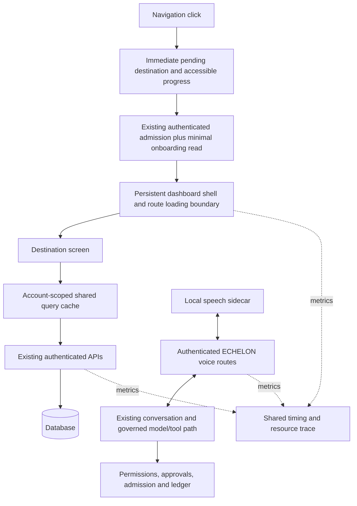

# ECHELON architecture build plan: performance, selectable speech and Higgsfield

Finalized for implementation 8 November 2026, America/Edmonton.

**Status: owner authorized implementation on 8 November 2026. This is the build contract, not a claim of completed Mac acceptance.**

Earlier cloud drafts were paused when the owner requested a plan. The owner has now authorized completing this scope end to end. Validate those drafts before reuse; preserve unrelated work. Implementation, independent review, local model readiness and real Mac acceptance remain distinct gates.

Repository: https://github.com/whinkproducts-alt/ECHELON-CORP
Reviewed main: `bcdd0caa18201cf1c0e09adc71aef7855365f495`.

## Executive recommendation

Use **one coordinated architecture with three separately testable implementation
tracks**: navigation performance, selectable speech services and Higgsfield media production. Share tracing,
request cancellation, lifecycle/readiness and resource budgets. Keep their code
changes, acceptance results and rollback controls distinguishable.

Start with a measured navigation baseline and immediate click feedback. Remove
unnecessary work before page rendering, then deduplicate data requests and stop
inactive polling. Integrate speech through ECHELON's existing authenticated and
governed conversation path. Test both together on the actual M3/16 GB Mac.

Do not treat the two tracks as one large unmeasured rewrite. Faster navigation
must be independently demonstrable, and a new voice provider must not become a
second permissions, memory or conversation system.

## 1. Problem and boundaries

The Founder reports that both sidebar pages and dashboard tabs can feel slow,
with little indication a click registered, and waits that can feel about a minute.

The source review established avoidable work and missing feedback, but did not
measure the reported full-minute stall. Ordinary Monitor/Conversation/Board tabs
use local React state; a server request alone cannot explain all delays on those
buttons. Browser long tasks, hydration failures, the exact running build, database
response times and Mac memory pressure still need a live trace.

The standalone local voice package is prepared, not proven installed or working
on the Mac. Its MLX/Metal inference, microphone and audible latency remain
unverified. Its separate Qwen conversation loop must not be wired around ECHELON's
existing model router, tool loop, permissions, memory, approvals or ledger.

### Protected invariants

- Preserve authentication, tenant isolation, onboarding and session revocation.
- Preserve permission classes, spend admission, protected-action approvals,
  content hashes, expiry, exact request identity, exactly-once use and ledger.
- Do not remove CSP/nonces, lockdown, Local-Only policy or security checks to
  improve a benchmark. Sensitive decisions cannot rely on stale UI data.
- Preserve existing typed conversations, draft state, selected project/persona,
  avatars/lipsync, accessibility and existing speech providers.
- No database reset, destructive seed, paid API call, model download, dependency
  upgrade, public deployment or credential change follows from this document.
- Future implementation needs explicit approval, an isolated branch, independent
  assurance and real owner acceptance. Uncommitted cloud drafts must be treated separately from the reviewed baseline.

## 2. Verified code findings

| ID | Evidence at reviewed commit | Implication |
|---|---|---|
| N1 | `apps/web/proxy.ts:88-98` awaits `/api/settings`; its GET at `app/api/settings/route.ts:89-96` reads profile and preferences | A full internal HTTP request and database reads sit ahead of each eligible page response, although only displayName is needed for onboarding. No explicit fetch deadline. |
| N2 | `app/layout.tsx:8` forces dynamic rendering; no `app/**/loading.tsx` was found | The old screen can remain during the server wait. Auth/nonce needs are legitimate and must remain. |
| N3 | `components/shell/nav-rail.tsx:29-43` derives active state from completed pathname, without a pending destination | Click acknowledgment is missing while navigation waits. Links already use Next Link. |
| N4 | Projects surface `:35-37` and Tasks surface `:24-26` fetch after client mount | A second loading phase follows page navigation; return visits have no shared query cache in these surfaces. |
| N5 | `lib/hooks/useTenantConfig.ts:111-116` fetches for each hook mount; `app/api/tenant/config/route.ts:9` performs upsert | Repeated consumers generate redundant configuration requests/database work. Persistent shell hooks do not all refetch on every click. |
| N6 | `components/shell/persona-context.tsx:44-50` refreshes on pathname changes | Further background traffic after navigation. Any optimization must preserve persona-switch correctness. |
| N7 | `components/premium/ECHELONDashboard.tsx:51-60` keeps hidden panels mounted; `DashboardMonitor.tsx:186-214` polls three endpoints | A hidden Monitor still polls when the document is visible; all three display updates wait for Promise.allSettled. |
| N8 | `lib/dashboard-client.ts` uses fetch without a default deadline | Read failures can leave long pending waits. The settings admission fetch has the same unbounded application-level behavior. |
| N9 | Ordinary dashboard tabs call setView directly; persona selection awaits persona.select | Distinguish local tab freezes from network-gated “Open conversation” actions. They need different diagnoses. |

Additional distinctions: session-version database reads already have a 15-second
process cache; do not count every auth call as a new DB query. Projects aggregates
are batched, not an N+1 defect. The packaged Docker build uses production Next
build/start, so development mode is not an established explanation. The startup
animation runs once per browser session, not on each page transition.

## 3. Target architecture

The diagram is a target, not a claim that these changes exist. The sidecar
connection needs authenticated transport and a deliberate Mac/Docker topology;
container loopback is not Mac loopback. Do not weaken Local-Only URL checks or
open broad CORS to work around that distinction.

### Navigation and data decisions

1. Keep the authenticated shell mounted across route transitions. Add generic,
   non-sensitive route-loading placeholders and an explicit pending destination.
2. Replace the full-settings HTTP detour with a minimal account-scoped onboarding
   readiness service. Select only required fields and reuse auth within a request.
   Define failure behavior without admitting an unverified user. Do not cache
   security authority indefinitely or silently remove onboarding enforcement.
3. Use the already-declared TanStack Query dependency for a shared authenticated
   query cache, after checking existing consumers and compatibility. No new
   competing query framework is needed. Instantiate/reset by account/session;
   never share private cached responses across users or sign-out.
4. Fetch tenant configuration once per authenticated shell and expose a context.
   Invalidate it after successful settings/branding mutations. Preserve defaults
   and white-label behavior. Do not run an upsert for every new consumer merely
   to read existing configuration.
5. Keep the authoritative persona in its provider. Refresh after successful
   switches, explicit invalidation and suitable focus/staleness events instead
   of every unrelated pathname, subject to stale-session/persona tests.
6. Pause Monitor polling when its panel or document is inactive. Preserve the
   mounted conversation state. Resolve independent Monitor sections independently
   so a slow endpoint does not hold successful sections behind it.
7. Introduce bounded read/cancellation policies. A route change aborts obsolete
   read requests; an error is visible and retryable. A browser cancellation does
   not prove a database query or protected write stopped. Never blindly retry
   mutations, approvals or uncertain tool executions.
8. Paginate large task lists and measure project aggregate cost before changing
   indexes. Retain tenant/access filtering and stable pagination semantics.

## 4. Implementation phases

| Phase | Work and outputs | Exit gate | Rollback |
|---|---|---|---|
| P0: establish baseline | Identify actual running build/origin; trace five representative actions; capture request and main-thread timing plus Mac memory pressure | Locate wait in admission, server, client data, main thread or system pressure; distinguish cold/warm and sidebar/local tab | Read-only baseline; no runtime settings changed |
| P1: immediate response | Pending destination, keyboard-accessible progress, route loading/error boundaries; preserve drafts and shell | A click visibly registers promptly; old/failed navigation cannot leave a false active destination; no private placeholder leakage | Revert this UI-only change without touching backend/security |
| P2: admission path | Minimal onboarding readiness read replaces full-settings self-fetch; deliberate request deadline/failure handling; auth unchanged | Trace shows no internal full-settings fetch on routine navigation; onboarding/session/tenant tests pass | Restore previous admission implementation if correctness fails |
| P3: shared data and idle work | Account-scoped query cache, shared tenant config, freshness-aware persona refresh, inactive polling suspension, independent Monitor updates | Repeated visits reuse permitted data; mutations revalidate; sign-out/account switches clear private cache; hidden Monitor does not poll | Revert individual query/poll changes; retain safe cancellation and data ownership |
| P4: measured hotspots | Address only observed DB, payload, bundle, image, render or main-thread hotspots; paginate where justified | Before/after trace demonstrates improvement on the affected route; no invented N+1 or animation diagnosis | Revert each measured optimization independently |
| V1: speech compatibility | Local STT/TTS adapter behind existing ECHELON voice routes; correct media formats, sample rates and voice identifiers | Actual Mac push-to-talk → canonical ECHELON response → audible local speech; typed chat and policy gates preserved | Select previous configured speech provider; no schema/data conversion required |
| V2: optional voice speed | Turn detection, bounded streamed sentence/audio queues, interruption and lockdown-aware cancellation | Actual end-of-speech-to-audible-response metrics; no stale/cross-turn audio; no weakened approval gate | Return to working push-to-talk/whole-answer playback |
| C1: combined acceptance | Navigation under realistic voice and worker load on M3/16 GB | Navigation remains responsive, voice timing recorded, no sustained swap growth, all security/product tests pass | Disable new voice path and/or individual performance changes separately |

P1 can be delivered independently after implementation approval. Complete P0
before attributing the minute-long freeze or promising a speed improvement.

## 5. Measurements and provisional targets

These are proposed engineering targets for agreement after baseline, not measured
results or performance guarantees. Use the real personal production build and
representative data. Measure cold and warmed runs separately.

| Metric | Initial target |
|---|---|
| Click to first visible acknowledgment | p95 at or below 100 ms on the target Mac |
| Ordinary local dashboard tab switch | p95 at or below 200 ms when warm |
| Warm sidebar click to destination shell/loading state | p95 at or below 500 ms |
| Warm sidebar click to useful data | Initial goal p95 at or below 1.5 s; refine from DB/host baseline |
| Pending read failure | Bounded, visible failure; no unexplained minute-long silent wait |
| Memory under voice + navigation | No sustained increase in swap or unbounded queue growth |

For a route, timestamp click, acknowledgment, navigation request, admission
completion, server response, client mount and useful data. For voice, timestamp
last voiced sample, endpoint/VAD completion, ASR completion, governed chat start,
first model text, first speakable segment, first audio chunk and actual playback.
A 480 ms silence cutoff is part of voice latency. The prototype's processing-to-
first-chunk number is not total audible latency.

Inspect the browser's long tasks and Mac memory pressure while switching local
tabs. Add server timing/correlation metadata without logging raw response bodies,
transcripts, prompts, secrets, approval codes or proprietary payloads. Do not
share an unredacted HAR or personal database snapshot.

## 6. Acceptance matrix

- Sidebar: click, keyboard activation, rapid successive clicks, canceled route,
  back/forward, cold destination, repeat destination, slow API and failed API.
- Dashboard tabs: Monitor, Conversation and Board respond without navigation;
  conversation draft/history state survives; persona-changing actions show their
  separate pending state instead of silently appearing stuck.
- Security: anonymous, expired/revoked session, cross-account cache access,
  onboarding incomplete, lockdown and Local-Only retain existing behavior.
- Data: task/project mutations invalidate relevant queries; account switch and
  sign-out cannot retain another account's data; no infinite stale status.
- Background: hidden Monitor stops polling, resumes correctly, avoids overlapping
  polls, and successful sections do not wait indefinitely for a failed section.
- Voice coexistence: capture, ASR, LLM, streaming speech, interruption and worker
  activity do not freeze navigation; bounded queues release on cancellation.
- Approvals: no fabricated Whisper confidence, no inference that verbal “yes” is
  authority, no bypass of request ID/code/hash/expiry/owner/permission checks.
- Accessibility: meaningful pending status for assistive technology, focus and
  keyboard behavior preserved, reduced motion respected.
- Independent assurance reviews all auth/data/permission changes. Run targeted
  regression tests, relevant type/lint/build checks, and owner Mac acceptance.
  A cloud/mock success is not a passed live Mac gate.

## 7. Benefits and limits of coordinating voice and performance

**Benefits:** one tracing vocabulary, one account/session boundary, common
cancellation semantics, shared service readiness/error UI, and a realistic total
16 GB memory budget. Removing duplicate polling also leaves more capacity for
local speech. Streaming design can be measured against the same main-thread and
resource traces used for navigation.

**Limits:** reducing navigation requests does not itself make speech synthesis
stream, and replacing TTS does not repair slow routing. A single combined code
change makes regressions and rollback harder to isolate. Separate work tracks
under the same architecture provide clearer evidence and safer rollout.

## 8. Required speech service selection

This section supersedes the older standalone PocketTTS/Qwen prototype recommendation. Do not add a second conversation brain. “VoiceStudio” means the previously reviewed VoiceStudio desktop/server application, not MyShell OpenVoice.

Provide three clearly labeled controls: **Auto**, **Whisper + Kokoro**, **VoiceStudio**. Preserve existing providers; these are additive integrations. Whisper supplies recognition and Kokoro supplies synthesis as one selectable pair. VoiceStudio supplies recognition and synthesis through its configured engines. Voice cloning/design is a VoiceStudio capability, not a prerequisite for basic conversation. Preserve the selected voice per service where supported.

Display configured, reachable, model-ready, last successful test, selected service, selection reason and last error separately. Never call a discovery response or HTTP 200 proof of successful inference. A manual choice must persist and take priority over daily Auto selection until the user returns to Auto. Store preferences and results account-scoped server-side; never rely on an unsigned browser cookie for authorization. Pin a service pair for an entire utterance/turn; changes take effect on the next turn. Never silently send audio to a cloud service.

### API contracts and adapters

Route all browser speech through the existing authenticated ECHELON STT/TTS routes, retaining lockdown, Local-Only, account boundaries and admission. A server-selected, allowlisted provider configuration determines the exact destination used by policy checks and dispatch. Do not validate one endpoint then dispatch to another. Provider credentials remain server-side. Refuse redirects carrying credentials and arbitrary user-supplied endpoints. Bound audio size, text length, concurrency and request deadlines.

Verified against the checked VoiceStudio source:

- Recognition: POST `/v1/audio/transcriptions`, multipart `file`, `model=whisper-1`, JSON result containing `text`.
- Synthesis: POST `/v1/audio/speech`, JSON `model=tts-1`, `input`, `voice`, `response_format=wav`. The `alloy` alias resolves to the active default; discover/validate actual engine voices rather than promising one universal voice.
- Bearer authentication is supported using its configured API key. Discovery at `/.well-known/voicestudio-speech` describes a contract, not loaded-model readiness.

Confirm these contracts against the exact installed version before implementation. Write independent adapters so a provider upgrade cannot alter ECHELON permissions or conversations. Whisper/Kokoro adapter endpoints must have equivalent explicit contracts and a real readiness check. Serve genuine encoded audio with the correct content type and sample rate; do not label WAV as MP3. Handle Safari microphone formats through tested decoding/conversion rather than assuming WebM support. Never invent transcription confidence or use a transcript alone as authority to approve protected actions.

### Deployment topology and licenses

The target is an M3 Mac with 16 GB unified memory. Container localhost is not the Mac host. Document a deliberate topology: either speech adapters share the web network namespace with actual loopback listeners, or use a narrowly authenticated host bridge with policy explicitly permitting that exact endpoint. No broad CORS, public listener or blanket Local-Only exemption. Give speech processes only their own token/cache configuration, not the entire web secret environment. Download models only in an explicit setup step; health checks must not install software or fetch model weights. Avoid loading all engines simultaneously if that causes swap; expose cold-start and warm-start status.

VoiceStudio app code is AGPL-3.0; do not copy it into ECHELON. Verify API-only integration and any redistribution obligations before packaging an external runtime. The current repository license policy permits MIT/Apache/BSD/ISC dependencies; proposed Whisper/Kokoro runtimes can introduce GPL/LGPL transitive components. A future builder must inventory exact pinned versions and obtain an explicit exception or choose compliant alternatives. Generic approval to write this plan is not a license exception. Do not quietly omit the runtime while describing the package as inference-ready.

## 9. Daily automatic health and performance selection

Schedule for **5:00 a.m. in the user's configured IANA timezone**. Confirm the timezone during setup; do not assume UTC or a location based only on a cloud session. Retain manual choices. Run only for Auto mode, except a user-invoked test which must not change a manual choice.

Use one coordinator per account/day with a durable result record and bounded lease to avoid concurrent duplicate probes. A server worker can schedule when always running. If the app/Mac is off or asleep at 5 a.m., run one catch-up check when it next becomes available, before the next speech session. Do not promise a sleeping Mac will wake. Handle daylight-saving transitions without duplicate daily runs. Store scheduled local date, actual check time, provider/version, sample count, outcome, component latencies, failure category, score and selected pair; do not retain recordings, transcripts or secrets in health logs.

A check must establish authenticated reachability, loaded-model readiness, successful recognition of a bundled nonprivate known speech sample, and successful synthesis of a short fixed phrase. Silence alone is not a recognition-quality test. Validate recognized content against a documented tolerance and validate the returned audio container, duration and nonempty playable content. Avoid real microphone recordings, user files and paid/cloud probes. Unsupported or failed probes produce degraded/unknown status, not an invented pass.

Measure cold startup separately from warmed STT and time to playable TTS audio using bounded repeated samples. Use a published score and sample count; these probes estimate service performance, not total assistant reasoning latency or broad speech accuracy. Prefer the only healthy pair. If both healthy, choose the better measured pair, retaining yesterday's healthy pair when within a provisional 20 percent band to avoid needless switching; calibrate this threshold on the Mac. If neither healthy, keep text available, show the reason and offer retry/manual diagnostics. Re-check eligibility at actual use; never play an old turn or replay a protected request during fallback. Runtime failures may choose the other verified pair for the next turn, with visible notice and no cloud fallback.

Acceptance: both healthy, either unavailable, reachable-but-model-missing, wrong transcript, invalid/empty audio, timeout, cancellation, app restart, duplicate jobs, day rollover, timezone change, daylight saving, asleep-at-5 catch-up, manual override, account isolation and mid-turn selection stability. Exercise on the actual Mac under navigation load. No permanent background installer or new model download is part of a health check.

## 10. Higgsfield: media production asset

Keep Higgsfield separate from speech selection. Add a Media Studio entry and a reusable governed image/video production capability that authorized ECHELON media, branding and other teams can use. Team membership alone does not grant spending or data-egress authority. Apply the existing permission engine, model router/admission, protected-action approval and ledger. Retain exact request/content binding, expiry and exactly-once execution. A frontend modal alone must never authorize a provider call.

Keep credentials server-side, encrypted using the existing secret mechanism, account-scoped, excluded from archives/logs, and rotatable. Do not use the key previously posted in conversation. Use the verified official provider origin with redirect and destination controls. Current official models inspected were Qwen Image 3 and Seedance 2 text generation endpoints; verify current identifiers, required inputs, asynchronous jobs, result retrieval and retention before coding. Do not conflate the separate OpenHiggsfield app with a completed ECHELON integration.

Before paid execution, establish an authoritative price/quote and reserved spend bound for the exact model/options. If a reliable bound is unavailable, show configured-but-blocked and block dispatch. An arbitrary environment estimate is not a verified ceiling. The architectural plan or installing a connector does not authorize paid test generation.

Explicitly confirm external transmission/public exposure when a workflow uploads assets. Restrict file size/type and signed upload-token scope, expiry and rate; no unprotected upload endpoint or automatic public publish. Keep prompts/media URLs out of routine logs. Protect status/result access by account, support safe cancellation semantics, and distinguish provider job cancellation from browser request cancellation. Store only required job/asset metadata and provenance. Team workflows must consume the same governed connector rather than inventing direct provider bypasses.

Acceptance: missing/invalid key, wrong account, Local-Only denial, insufficient permissions, unknown price, approval absent/expired/reused/mismatched, upload refusal, unsupported input, rate limit, timeout after uncertain dispatch, provider failure and unauthorized result retrieval. Unit tests use mocks; live paid generation requires a separate explicit authorized test. Document whether a deployment is merely configured or has passed a real generation.

## 11. LLM implementation sequence and required deliverables

1. Read repository AGENTS/CLAUDE instructions and current handoff; verify current main and working tree. Preserve/isolate the uncommitted cloud drafts. Reconfirm exact dependency/model licenses and installed API contracts. Do not treat this document as permission to merge, deploy or spend.
2. Establish the navigation baseline (P0), then independently implement P1/P2 and measured P3/P4 changes. Preserve all security invariants above.
3. Implement speech provider interfaces, account-scoped selection/preferences, external VoiceStudio adapter and Whisper/Kokoro adapter. Gate runtimes on resolved licenses and explicit setup. Validate codecs/readiness on Mac before enabling Auto.
4. Implement the daily 5 a.m. coordinator, durable result records, bounded probes, selection policy, manual override and next-turn pinning. Introduce migrations only through the existing non-destructive migration process.
5. Implement the governed Higgsfield media capability and UI. Resolve authoritative pricing before enabling execution. Keep speech and media paths distinct.
6. Add shared tracing/cancellation/resource budgets, then independently review auth, tenant boundaries, credentials, spend controls and regression risk. Run focused tests plus required lint/type/build checks; do not call a missing Prisma-generated-client failure a passed typecheck.
7. Test the combined system on the M3/16 GB Mac: microphone permission, both speech services, audible latency, manual/Auto selection, daily catch-up, navigation with speech active, memory pressure and approved media scenarios. No cloud/mock result substitutes for this gate.
8. Deliver code changes in separate reviewable units, version/config instructions without secrets, dependency/model license inventory, actual test evidence, unresolved blockers and per-track rollback instructions. A provider selector with no working engine is not completed speech integration.

Required implementation artifacts: provider contract tests; selection scheduler tests; navigation before/after trace; Mac acceptance checklist/results; migration/rollback notes if needed; setup guide; license/asset manifest; independent security review; explicit statement of live versus mocked provider testing. Keep performance, speech selection and media independently reversible. Preserve original data and original working speech providers.

This Markdown file is the requested handoff. It contains requirements and proposed design, not a completed install or a claim of measured Mac performance.

## 12. Winx/WHINK avatar speech animation correction

Owner reports unacceptable lip movement during speech. Add this as a separately testable build requirement alongside provider integration. This is an architectural requirement, not a completed visual fix.

Source findings: `components/avatar/avatar-engine.ts` uses six categorical mouth shapes derived from loudness and optional spectral centroid; without an audio sample it synthesizes a periodic level and pseudo-random centroid. `avatar-canvas.tsx` draws generated mouth sprites over a portrait. This is not phoneme/viseme alignment. Establish which path the actual user-visible screen uses before attributing the reported visual defect to a specific fallback.

Implementation: connect animation to the exact audio being played and the playback clock, rather than request start/completion or text length. Prefer genuine provider phoneme/viseme timestamps when available and verified. Otherwise evaluate a licensed local aligner; never present amplitude-only movement as accurate lip sync. For an interim audio-reactive mode, use restrained smoothed motion, silence closure, calibrated portrait anchors and explicit approximate status. Avoid synthetic talking motion if no audio feed exists; provide a neutral fallback. Preserve breathing, stable portrait position, reduced-motion settings and an animation-off control. VoiceStudio selection alone does not fix avatar timing.

Playback lifecycle must drive start, pause, interruption, seek, completion, error and cancellation; stop mouth motion immediately when playback stops and clear previous-turn timestamps. Test both Whisper/Kokoro and VoiceStudio output without changing approval semantics. Review a side-by-side short audible sample with the owner before accepting appearance. Measure playback-to-mouth offset and drift on the Mac; proposed target <=100 ms offset, subject to measured aligner feasibility. Test silence, plosives, rounded vowels, rapid speech, long utterances, buffering, autoplay refusal, background tabs and reduced motion. Never claim realistic or synchronized lips based only on unit tests.

VoiceStudio acceptance prerequisite: verify installation of its actual runtime and selected STT/TTS models on the Mac, run one fixed short text-to-speech sample, then a microphone transcription and conversational round trip. The old cloud installation has neither inference readiness nor access to the Mac microphone. Its interface launch is not a passed speech test.

## 13. Stable per-agent voice assignments

Provide account-scoped voice assignments for WHINK, MAMBA and other authenticated roster/persona IDs, with separate voice IDs for each speech service. Use stable internal speaker IDs, never mutable display labels as authorization. Show available voices per configured service and permit a short explicit sample. Store selections durably and use the selected speaker's mapping on every TTS turn, including after daily Auto switches services. A voice ID valid for one engine must not be sent to another engine without validation; if a stored voice is unavailable, explain a deliberate service-specific fallback.

Custom cloning is optional setup requiring an authorized source voice and valid model/asset licenses. Do not imply that installing VoiceStudio automatically creates cloned voices. Assignments affect speech only, never personas' permission classes or access. Verify account isolation, reload/restart persistence, service changes, invalid/missing voice IDs, speaker changes during playback and cancellation.
